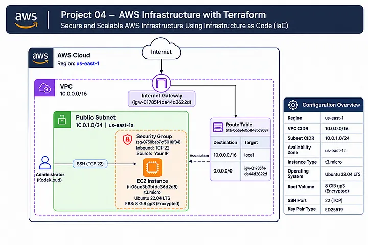
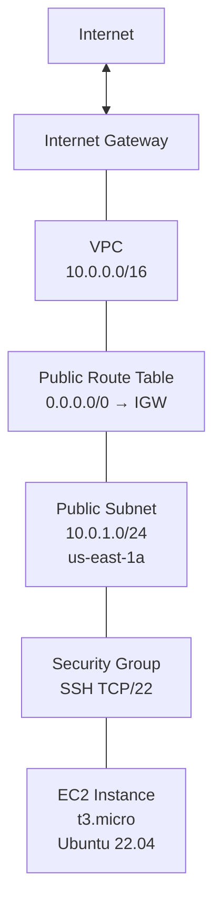
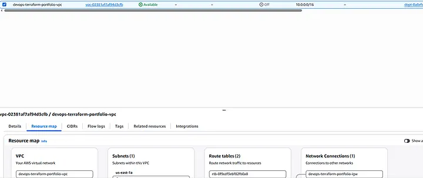
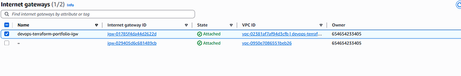

# AWS Infrastructure Provisioning with Terraform
test
**Implementasi Infrastructure as Code untuk Membangun Infrastruktur
Cloud pada Amazon Web Services**

[](https://aws.amazon.com/)
[](https://www.terraform.io/)
[](https://ubuntu.com/)
[]()
[]()

------------------------------------------------------------------------

## 01. Gambaran Umum Proyek

**AWS Infrastructure Provisioning with Terraform** merupakan proyek
implementasi *Infrastructure as Code* (IaC) untuk membangun dan
mengelola infrastruktur cloud menggunakan Amazon Web Services (AWS) dan
Terraform.

Proyek ini menerapkan pendekatan Infrastructure as Code, yaitu
pengelolaan resource cloud melalui konfigurasi kode. Dengan pendekatan
tersebut, proses provisioning menjadi lebih terstruktur, konsisten, dan
mudah direproduksi.

Infrastruktur yang dibangun mencakup Virtual Private Cloud (VPC), Public
Subnet, Internet Gateway, Route Table, Security Group, SSH Key Pair, dan
Amazon EC2 Instance.

Terraform digunakan untuk mengelola seluruh resource melalui pendekatan
modular dengan memisahkan konfigurasi Networking dan Compute.

### Tujuan Proyek

-   Memahami konsep Infrastructure as Code menggunakan Terraform.
-   Membangun jaringan AWS menggunakan Terraform.
-   Mengimplementasikan VPC dan Public Subnet.
-   Menghubungkan jaringan ke internet menggunakan Internet Gateway.
-   Mengimplementasikan Security Group untuk membatasi akses jaringan.
-   Melakukan provisioning EC2 menggunakan Terraform.
-   Mengelola konfigurasi menggunakan Terraform Modules.
-   Melakukan validasi dan deployment infrastruktur.
-   Memverifikasi resource AWS setelah deployment.

### Teknologi yang Digunakan

  Kategori                 Teknologi
  ------------------------ ---------------------------------------------------
  Cloud Provider           Amazon Web Services (AWS)
  Infrastructure as Code   Terraform
  Region                   `us-east-1`
  Operating System         Ubuntu 22.04
  Compute                  Amazon EC2
  Networking               VPC, Public Subnet, Internet Gateway, Route Table
  Network Security         Security Group
  SSH Authentication       ED25519 Key Pair
  Storage                  EBS gp3
  CLI                      AWS CLI
  Version Control          Git
  Lab Environment          KodeKloud AWS Playground
  Repository               GitHub

------------------------------------------------------------------------

## 02. Arsitektur Infrastruktur

### 2.1 Topologi Infrastruktur

Arsitektur project menggunakan satu VPC dengan satu Public Subnet yang
ditempatkan pada Availability Zone `us-east-1a`.

Internet Gateway digunakan sebagai jalur komunikasi antara VPC dan
internet. Route Table mengarahkan trafik keluar melalui Internet
Gateway.

EC2 Instance ditempatkan di dalam Public Subnet dan menggunakan Security
Group untuk membatasi akses SSH.

**Gambar 01 -- AWS Infrastructure Architecture**



### 2.2 Diagram Arsitektur



### 2.3 Spesifikasi Infrastruktur

  Komponen             Konfigurasi
  -------------------- ------------------
  Cloud Provider       AWS
  Region               `us-east-1`
  VPC CIDR             `10.0.0.0/16`
  Public Subnet        `10.0.1.0/24`
  Availability Zone    `us-east-1a`
  EC2 Instance Type    `t3.micro`
  Operating System     Ubuntu 22.04
  Root Volume          8 GiB gp3
  EBS Encryption       Enabled
  SSH Authentication   ED25519 Key Pair

------------------------------------------------------------------------

## 03. Implementasi Proyek

Implementasi dilakukan secara bertahap, dimulai dari persiapan
environment, penyusunan struktur Terraform, pembangunan networking,
konfigurasi compute, validasi, deployment, hingga verifikasi akses dan
Terraform State.

### Step 1 --- Environment Preparation

**Tujuan:** Memastikan seluruh tools dan environment yang diperlukan
tersedia sebelum proses provisioning infrastruktur AWS dilakukan.

**Tools yang Digunakan:**

-   Terraform
-   AWS CLI
-   Git
-   KodeKloud AWS Playground

AWS CLI digunakan untuk memverifikasi autentikasi dan mengakses
informasi AWS. Terraform digunakan sebagai tool utama untuk
mendefinisikan dan mengelola infrastruktur.

**Implementasi:**

``` bash
terraform version
aws --version
git --version
aws sts get-caller-identity
```

**Hasil Validasi:**

Pemeriksaan environment digunakan untuk memastikan Terraform, AWS CLI,
dan Git tersedia serta AWS CLI dapat mengakses identitas akun atau role
yang digunakan pada playground.

**Dokumentasi Screenshot -- Environment Preparation**

Letakkan screenshot pemeriksaan versi tools dan verifikasi identitas AWS
CLI di sini apabila bukti tersebut tersedia.

------------------------------------------------------------------------

### Step 2 --- Terraform Project Structure

**Tujuan:** Menyusun struktur project Terraform dengan pendekatan
modular agar konfigurasi lebih terorganisasi dan mudah dikembangkan.

**Struktur Direktori:**

``` text
04-aws-terraform/
├── README.md
├── docs/
├── environments/
│   └── playground/
│       ├── main.tf
│       ├── provider.tf
│       ├── variables.tf
│       ├── outputs.tf
│       └── versions.tf
└── modules/
    ├── networking/
    │   ├── main.tf
    │   ├── variables.tf
    │   └── outputs.tf
    └── compute/
        ├── main.tf
        ├── ec2.tf
        ├── key_pair.tf
        ├── variables.tf
        └── outputs.tf
```

**Pembagian Modul:**

  -----------------------------------------------------------------------
  Modul                               Tanggung Jawab
  ----------------------------------- -----------------------------------
  `networking`                        Mengelola VPC, subnet, Internet
                                      Gateway, dan route table

  `compute`                           Mengelola EC2, Security Group, dan
                                      SSH Key Pair

  `environments/playground`           Mengatur konfigurasi environment
                                      dan pemanggilan module
  -----------------------------------------------------------------------

Networking module bertanggung jawab mengelola komponen jaringan AWS.
Compute module bertanggung jawab mengelola EC2, Security Group, dan SSH
Key Pair.

**Dokumentasi Screenshot -- Terraform Project Structure**

Letakkan screenshot struktur direktori project Terraform yang
memperlihatkan folder `environments` dan `modules` di sini.

------------------------------------------------------------------------

### Step 3 --- Membangun AWS Networking

**Tujuan:** Membangun fondasi jaringan AWS menggunakan Terraform sebagai
tempat EC2 Instance akan ditempatkan.

**Resource Terraform yang Digunakan:**

-   `aws_vpc`
-   `aws_subnet`
-   `aws_internet_gateway`
-   `aws_route_table`
-   `aws_route`
-   `aws_route_table_association`

VPC menggunakan CIDR `10.0.0.0/16`, sedangkan Public Subnet menggunakan
CIDR `10.0.1.0/24`.

Public Subnet dikonfigurasi agar instance yang diluncurkan dapat
memperoleh Public IPv4 Address. Internet Gateway dihubungkan ke VPC dan
Route Table dikonfigurasi menggunakan destination `0.0.0.0/0`.

**Hasil Validasi:**

-   VPC menggunakan CIDR `10.0.0.0/16`.
-   Public Subnet menggunakan CIDR `10.0.1.0/24`.
-   Public Subnet ditempatkan pada Availability Zone `us-east-1a`.
-   Internet Gateway dihubungkan ke VPC.
-   Route Table memiliki rute default `0.0.0.0/0` menuju Internet
    Gateway.
-   Route Table diasosiasikan dengan Public Subnet.

**Dokumentasi Screenshot -- VPC**

Gambar berikut memperlihatkan VPC yang dibuat menggunakan Terraform
beserta konfigurasi CIDR yang digunakan.



**Dokumentasi Screenshot -- Public Subnet**

Gambar berikut memperlihatkan Public Subnet pada VPC, termasuk CIDR
block dan Availability Zone `us-east-1a`.


**Dokumentasi Screenshot -- Internet Gateway**

Gambar berikut memperlihatkan Internet Gateway yang telah dibuat dan
dihubungkan dengan VPC.



**Dokumentasi Screenshot -- Route Table**

Gambar berikut memperlihatkan konfigurasi Route Table yang mengarahkan
trafik `0.0.0.0/0` melalui Internet Gateway serta asosiasinya dengan
Public Subnet.


------------------------------------------------------------------------

### Step 4 --- Konfigurasi EC2 dan Security Group

**Tujuan:** Membangun EC2 Instance dan mengatur akses jaringan
menggunakan Security Group melalui Compute module.

Security Group digunakan untuk mengatur akses masuk ke EC2. Konfigurasi
project mengizinkan koneksi SSH melalui TCP port 22 dari alamat IP
tertentu. Pembatasan ini ditujukan agar akses SSH tidak terbuka untuk
seluruh alamat internet.

**Spesifikasi EC2:**

  Komponen                 Konfigurasi
  ------------------------ ------------------
  Instance Type            `t3.micro`
  AMI / Operating System   Ubuntu 22.04
  Root EBS Volume          8 GiB gp3
  EBS Encryption           Enabled
  SSH Authentication       ED25519 Key Pair
  SSH Port                 TCP/22

**Hasil Validasi:**

Compute module mencakup EC2 Instance, Security Group, dan SSH Key Pair.
Aturan inbound SSH menggunakan sumber alamat IP tertentu sesuai
konfigurasi project.

**Dokumentasi Screenshot -- Security Group Configuration**

Gambar berikut memperlihatkan konfigurasi Security Group, khususnya
inbound rule untuk koneksi SSH melalui TCP port 22.


------------------------------------------------------------------------

### Step 5 --- Terraform Validation dan Planning

**Tujuan:** Memeriksa format, validitas konfigurasi, dan rencana
perubahan resource sebelum deployment dilakukan.

**Implementasi:**

Memformat konfigurasi Terraform:

``` bash
terraform fmt -recursive
```

Memvalidasi konfigurasi:

``` bash
terraform validate
```

Melihat rencana deployment:

``` bash
terraform plan
```

**Hasil Validasi:**

Terraform Validate menghasilkan:

``` text
Success! The configuration is valid.
```

Terraform Plan menghasilkan:

``` text
Plan: 9 to add, 0 to change, 0 to destroy.
```

Hasil tersebut menunjukkan bahwa Terraform merencanakan pembuatan
sembilan resource AWS tanpa perubahan atau penghapusan resource yang
sudah ada.

**Dokumentasi Screenshot -- Terraform Validation and Plan**

Gambar berikut memperlihatkan hasil `terraform validate` dan
`terraform plan`, termasuk ringkasan sembilan resource yang direncanakan
untuk dibuat.


------------------------------------------------------------------------

### Step 6 --- Deployment Menggunakan Terraform Apply

**Tujuan:** Melakukan provisioning seluruh resource AWS berdasarkan
konfigurasi dan execution plan Terraform yang telah diperiksa.

**Implementasi:**

``` bash
terraform apply
```

Setelah meninjau rencana deployment, proses dilanjutkan dengan
persetujuan melalui konfirmasi Terraform.

**Hasil Validasi:**

Deployment menghasilkan output:

``` text
Apply complete! Resources: 9 added, 0 changed, 0 destroyed.
```

Sembilan resource berhasil dibuat di AWS berdasarkan hasil Terraform
Apply.

**Dokumentasi Screenshot -- Terraform Apply**

Gambar berikut memperlihatkan proses `terraform apply` dan ringkasan
hasil deployment yang menunjukkan sembilan resource berhasil dibuat.


**Dokumentasi Screenshot -- AWS EC2 Console**

Gambar berikut memperlihatkan EC2 Instance yang telah dibuat melalui
Terraform dan mencapai status `running` pada AWS Console.


------------------------------------------------------------------------

### Step 7 --- Infrastructure Verification

**Catatan:** Bagian Step 7 tidak dijelaskan secara terpisah pada materi
sumber yang diberikan. Oleh karena itu, tidak ditambahkan aktivitas atau
hasil pengujian baru agar dokumentasi tetap sesuai dengan bukti
implementasi yang tersedia.

------------------------------------------------------------------------

### Step 8 --- SSH Access ke EC2

**Tujuan:** Memverifikasi akses administratif ke EC2 Instance
menggunakan SSH Key Pair yang telah dikonfigurasi.

**Implementasi:**

Lakukan koneksi SSH menggunakan alamat Public IPv4 EC2 dan private key
yang sesuai dengan Key Pair yang dibuat. Contoh format perintah:

``` bash
ssh -i <private-key-file> ubuntu@<EC2_PUBLIC_IP>
```

Ganti `<private-key-file>` dan `<EC2_PUBLIC_IP>` dengan lokasi private
key serta alamat IP EC2 aktual.

**Hasil Validasi:**

Koneksi SSH digunakan untuk memastikan EC2 dapat diakses menggunakan
akun dan key yang sesuai. Status keberhasilan koneksi perlu didukung
oleh hasil pengujian aktual.

**Dokumentasi Screenshot -- SSH Access to EC2**

Gambar berikut memperlihatkan proses koneksi SSH yang berhasil ke EC2
Instance menggunakan SSH Key Pair.


------------------------------------------------------------------------

### Step 9 --- Terraform State Management

**Tujuan:** Memahami pengelolaan Terraform State sebagai pemetaan antara
konfigurasi Terraform dan resource AWS yang dikelola.

Project ini menggunakan **default Local State backend**. Remote State
menggunakan AWS S3 belum diterapkan dalam implementasi ini.

**Implementasi:**

Memeriksa daftar resource yang dikelola Terraform:

``` bash
terraform state list
```

**Hasil Validasi:**

Perintah `terraform state list` digunakan untuk menampilkan resource
yang tercatat di Terraform State setelah proses deployment.

**Dokumentasi Screenshot -- Terraform State List**

Gambar berikut memperlihatkan daftar resource AWS yang tercatat dan
dikelola oleh Terraform State.


------------------------------------------------------------------------

## 04. Ringkasan Hasil Implementasi

Berdasarkan hasil yang tercantum pada materi project:

  Area                   Hasil
  ---------------------- --------------------------------------------------
  Terraform Validation   `Success! The configuration is valid.`
  Terraform Plan         9 to add, 0 to change, 0 to destroy
  Terraform Apply        9 added, 0 changed, 0 destroyed
  AWS EC2                Berhasil mencapai status `running`
  AWS CLI Verification   EC2 diverifikasi melalui AWS CLI
  SSH Access             Bukti koneksi SSH disediakan pada materi project
  Terraform State        Menggunakan default Local State backend
  Remote State S3        Belum diterapkan

------------------------------------------------------------------------

## 05. Struktur Repository

Source code dan konfigurasi Terraform dikelola menggunakan Git dan
tersedia pada GitHub.

Project ini berada pada direktori `04-aws-terraform/` di dalam
repository berikut:

[RichardAkbar/devops-engineering-portfolio](https://github.com/RichardAkbar/devops-engineering-portfolio)

------------------------------------------------------------------------

## 06. Technical Skills Demonstrated

  -----------------------------------------------------------------------
  Area                                Implementasi
  ----------------------------------- -----------------------------------
  Infrastructure as Code              Provisioning resource AWS
                                      menggunakan Terraform

  Cloud Infrastructure                Pengelolaan resource Amazon Web
                                      Services

  Terraform Modules                   Pemisahan konfigurasi Networking
                                      dan Compute

  Cloud Networking                    VPC, Public Subnet, Internet
                                      Gateway, dan Route Table

  Network Security                    Security Group dan pembatasan akses
                                      SSH

  Compute Provisioning                Deployment Amazon EC2

  SSH Administration                  Akses EC2 menggunakan ED25519 Key
                                      Pair

  Terraform Workflow                  `fmt`, `validate`, `plan`, dan
                                      `apply`

  State Management                    Pemeriksaan Terraform Local State

  Cloud Verification                  Verifikasi resource melalui AWS
                                      Console dan AWS CLI

  Version Control                     Git dan GitHub
  -----------------------------------------------------------------------

------------------------------------------------------------------------

## 07. Kesimpulan

Project **AWS Infrastructure Provisioning with Terraform** berhasil
mengimplementasikan Infrastructure as Code untuk membangun infrastruktur
cloud pada Amazon Web Services.

Infrastruktur yang dibangun mencakup VPC, Public Subnet, Internet
Gateway, Route Table, Security Group, SSH Key Pair, dan EC2 Instance.
Konfigurasi Terraform disusun menggunakan pendekatan modular dengan
pemisahan Networking dan Compute.

Hasil Terraform Validate menunjukkan bahwa konfigurasi valid. Terraform
Plan merencanakan sembilan resource untuk dibuat, sedangkan Terraform
Apply menyelesaikan deployment dengan hasil sembilan resource
ditambahkan tanpa perubahan atau penghapusan resource.

EC2 Instance berhasil mencapai status `running` dan resource AWS
diverifikasi melalui AWS CLI. Project ini juga menggunakan Terraform
Local State untuk mencatat resource yang dikelola, sementara Remote
State menggunakan AWS S3 belum diterapkan.

Melalui project ini, praktik pengelolaan infrastruktur cloud dilakukan
secara terstruktur menggunakan Terraform, mulai dari penyusunan
konfigurasi, validasi, planning, provisioning, hingga verifikasi
resource AWS.

**Project Status: Terraform Deployment Completed.**

------------------------------------------------------------------------

`<sub>`{=html}Project: AWS Infrastructure Provisioning with
Terraform`</sub>`{=html}

`<sub>`{=html}Platform: KodeKloud AWS Playground`</sub>`{=html}

`<sub>`{=html}Repository: [GitHub --
devops-engineering-portfolio](https://github.com/RichardAkbar/devops-engineering-portfolio)`</sub>`{=html}
